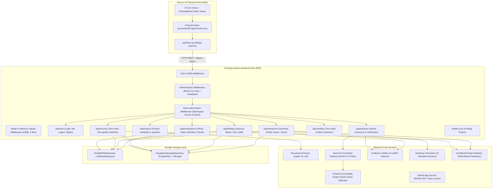
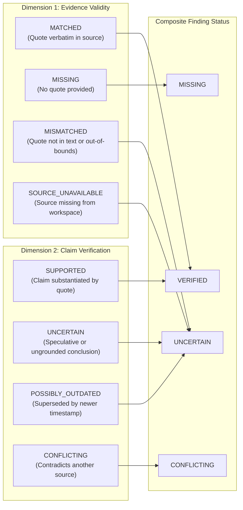

# KnoTrail: Reference Backend Architecture & Specification

**Document Type**: Architectural Discovery & Specification  
**Scope**: Comprehensive Reference for Independent Backend Implementation  
**Project**: KnoTrail — Source-Traceable Knowledge Handover Platform  
**Team**: Deploy_or_Die (Samyak Gedam & Sanshrey Sanagar)  
**Hackathon**: CodersInPune Hackathon 2026 — Final Round 3 Preparation  
**Target File**: `.planning/OWN_BACKEND_REFERENCE_ARCHITECTURE.md`  

---

## Executive Summary & Purpose

This document provides a complete, read-only architectural analysis of the existing KnoTrail backend. It serves as an authoritative specification for developing a new, independent backend implementation. 

### Development Invariants
1. **Reference Only**: The existing backend codebase is a functional and behavioural reference. Its code will not be blindly copied.
2. **Contract Preservation**: All frontend API contracts, parameter formats, response envelopes, status codes, and TypeScript interfaces must remain fully compatible.
3. **Core Workflow Governance**: The pipeline follows the invariant cycle:  
   $$\text{RECONSTRUCT} \longrightarrow \text{VERIFY} \longrightarrow \text{REVIEW} \longrightarrow \text{HANDOVER}$$
4. **Incognito & Zero-Auth Invariant**: Visitors and judges must be able to experience the complete demonstration workflow in a clean Incognito/Private browser window without encountering login gates, registration forms, or auth redirects.
5. **Zero Fake AI & Zero Ungrounded Claims**: The backend must never generate fabricated findings or mock hallucinations. Every finding must link to verbatim source text with verifiable coordinates.

---

## System Architecture Overview



---

## 1. Existing Backend Routes & Middleware

### Current Functionality
The backend is an Express 5 application (`backend/app.ts`, `backend/server.ts`) listening on port 4000 (configurable via `PORT`). It handles request parsing, security hardening, CORS enforcement, authentication token extraction, workspace membership verification, file uploads, and routing to 8 feature modules.

### Middleware Stack
1. **Process Security**:
   - `app.disable('x-powered-by')` removes Express fingerprinting.
   - Sets headers `X-Content-Type-Options: nosniff` and `X-Frame-Options: DENY`.
2. **CORS Middleware (`backend/middleware/cors.ts`)**:
   - Parses comma-separated `CORS_ORIGINS` (defaults to local origins `http://localhost:3000`, `http://localhost:3001`, `http://127.0.0.1:3000`, `http://127.0.0.1:3001`).
   - Rejects wildcards (`*`) in production.
   - Evaluates `Origin` header; if allowed, sets `Access-Control-Allow-Origin: <origin>`, `Access-Control-Allow-Methods: GET, POST, PATCH, DELETE, OPTIONS`, `Access-Control-Allow-Headers: Content-Type, Authorization, X-Workspace-ID, Range`, and `Access-Control-Max-Age: 86400`.
   - Handles `OPTIONS` preflight requests immediately with HTTP 204 (or 403 if disallowed origin).
   - Allows server-to-server or curl requests missing an `Origin` header.
3. **Body Parsers**:
   - `express.json({ limit: '10mb' })`
   - `express.urlencoded({ extended: true, limit: '10mb' })`
4. **Upload Middleware (`backend/middleware/upload.ts`)**:
   - Uses `multer.memoryStorage()` so uploaded documents remain in memory buffers for immediate parsing and SHA-256 calculation.
   - Enforces `limits: { fileSize: 10 * 1024 * 1024 (10 MB), files: 5 }`.
   - Handles `multer.MulterError` codes (`LIMIT_FILE_SIZE`, `LIMIT_FILE_COUNT`) returning standardized JSON `{ error: ... }`.
5. **Authentication Middleware (`backend/middleware/auth.ts`)**:
   - Mounted globally under `/api`.
   - Parses `Authorization: Bearer <token>`.
   - Validates signed dev HMAC tokens (`kt_hmac.*`) or Supabase JWTs.
   - Populates `req.user: { userId, email, authProvider }`.
   - Non-blocking: missing authorization headers pass through with `req.user = undefined` so public demo access is never blocked.
6. **Role Authorization Middleware (`backend/middleware/roleAuth.ts`)**:
   - `requireWorkspaceAccess`:
     - Extracts `workspaceId` from query string, JSON body, route parameters, or URL path.
     - Enforces regex `^[a-zA-Z0-9_-]{3,64}$` to strictly block path traversal.
     - If workspace is unprotected/anonymous (`ws_anon_*`), allows demo access, accepts `X-Demo-Perspective` header for UI simulation, and populates `req.workspaceAuth`.
     - If workspace is protected, mandates authenticated `req.user` (HTTP 401) and database membership check via `storage.getWorkspaceMember` (HTTP 403 if not registered). Client headers like `X-KnoTrail-Role` are strictly ignored.
   - `requireRole(allowedRoles)`:
     - Enforces caller's authoritative role matches `allowedRoles` array, otherwise returns HTTP 403 Forbidden.
7. **Health Probes (`backend/routes/health.ts`)**:
   - `GET /health/live`: Lightweight process liveness check, returns 200 with uptime.
   - `GET /health/ready`: Deep dependency readiness check, verifies database connectivity (with 4s timeout) and returns 200 or 503.

### Existing API Endpoints Table

| Method | Endpoint | Auth Required | Allowed Roles | Description | Status |
| :--- | :--- | :--- | :--- | :--- | :--- |
| `GET` | `/health/live` | No | Any | Process liveness probe | Implemented |
| `GET` | `/health/ready` | No | Any | Database readiness probe | Implemented |
| `GET` | `/api/auth/status` | No | Any | Capabilities discovery | Implemented |
| `POST` | `/api/auth/login` | No | Any | Authenticate & issue token | Implemented |
| `GET` | `/api/auth/me` | Optional | Any | User session introspection | Implemented |
| `POST` | `/api/auth/logout` | No | Any | Invalidate session client-side | Implemented |
| `GET` | `/api/workspaces` | Protected ws only | Any member | Retrieve project state | Implemented |
| `POST` | `/api/workspaces` | Protected ws only | `MANAGER`, `DEVELOPER` | Save project state | Implemented |
| `POST` | `/api/workspaces/reset`| Protected ws only | `MANAGER` | Reset to demo state | Implemented |
| `POST` | `/api/workspaces/:id/claim` | Yes | Authenticated user | Claim anonymous workspace | Implemented |
| `GET` | `/api/workspaces/:id/members` | Protected ws only | Any member | List workspace members | Implemented |
| `POST` | `/api/workspaces/:id/members` | Protected ws only | `MANAGER` | Add workspace member | Implemented |
| `DELETE`| `/api/workspaces/:id/members/:userId` | Protected ws only | `MANAGER` | Remove workspace member | Implemented |
| `GET` | `/api/projects/:id` | Protected ws only | Any member | Get project metadata | Implemented |
| `PATCH`| `/api/projects/:id` | Protected ws only | `MANAGER`, `DEVELOPER` | Update project metadata | Implemented |
| `GET` | `/api/sources` | Protected ws only | Any member | List ingested sources | Implemented |
| `POST` | `/api/sources` | Protected ws only | `MANAGER`, `DEVELOPER` | Add text/note source | Implemented |
| `POST` | `/api/sources/upload` | Protected ws only | `MANAGER`, `DEVELOPER` | Upload PDF, TXT, MD | Implemented |
| `GET` | `/api/sources/:id` | Protected ws only | Any member | Retrieve source metadata | Implemented |
| `DELETE`| `/api/sources/:id` | Protected ws only | `MANAGER`, `DEVELOPER` | Delete source & files | Implemented |
| `GET` | `/api/analysis/extract` | Protected ws only | Any member | AI telemetry & status | Implemented |
| `POST` | `/api/analysis/extract` | Protected ws only | `MANAGER`, `DEVELOPER` | Run Gemini extraction | Implemented |
| `POST` | `/api/analysis/verify` | Protected ws only | `MANAGER`, `DEVELOPER` | Run verification & conflicts | Implemented |
| `POST` | `/api/findings/:id/approve` | Protected ws only | `MANAGER`, `DEVELOPER` | Approve finding | Implemented |
| `POST` | `/api/findings/:id/reject` | Protected ws only | `MANAGER`, `DEVELOPER` | Reject finding with reason | Implemented |
| `POST` | `/api/findings/:id/edit` | Protected ws only | `MANAGER`, `DEVELOPER` | Edit finding (resets approval)| Implemented |
| `GET` | `/api/findings/:id/audit` | Protected ws only | Any member | Get audit trail | Implemented |
| `POST` | `/api/findings/:id/resolve-conflict` | Protected ws only | `MANAGER` | Resolve single finding conflict| Implemented |
| `POST` | `/api/conflicts/:id/resolve` | Protected ws only | `MANAGER` | Resolve two-sided conflict | Implemented |
| `GET` | `/api/handovers` | Protected ws only | Any member | Handover status & history | Implemented |
| `POST` | `/api/handovers/generate` | Protected ws only | `MANAGER`, `DEVELOPER` | Build 12-section handover | Implemented |
| `POST` | `/api/handovers/certify` | Protected ws only | `MANAGER` | Formally certify handover | Implemented |
| `GET` | `/api/handovers/export` | Protected ws only | Any member | Export Markdown/JSON/HTML | Implemented |
| `POST` | `/api/handovers/share` | Protected ws only | `MANAGER` | Generate public share token | Implemented |
| `DELETE`| `/api/handovers/share` | Protected ws only | `MANAGER` | Revoke public share link | Implemented |
| `GET` | `/api/handovers/share/:token` | No | Public zero-auth | View shared handover | Implemented |

---

## 2. Authentication & Role-Based Access Control (RBAC)

### Current Functionality
Implements server-verified authentication supporting both Supabase Auth access tokens and standalone cryptographically signed HMAC session tokens (`kt_hmac.*`), alongside constant-time demo credential verification.

### Token Specification
- Format: `kt_hmac.<header_b64>.<payload_b64>.<sig_b64>`
- Header: `{"alg": "HS256", "typ": "JWT"}`
- Payload: `{"sub": "<userId>", "email": "<email>", "iss": "knotrail-server", "aud": "knotrail-api", "iat": <now>, "exp": <now + 86400>}`
- Signature: `HMAC-SHA256(header.payload, SESSION_SECRET)`
- Verification checks: Constant-time signature comparison (`crypto.timingSafeEqual`), issuer check, audience check, expiry check (`exp >= now`), and valid subject ID.

### Role Hierarchy & Permissions Matrix

| Capability / Action | MANAGER | DEVELOPER | EXTERNAL | Public Anonymous |
| :--- | :---: | :---: | :---: | :---: |
| View Unprotected Demo Workspace | Yes | Yes | Yes | Yes |
| Access Protected Workspace | Registered Only | Registered Only | Registered Only | Blocked (401) |
| Add / Upload Documents | Yes | Yes | Blocked (403) | Yes (demo only) |
| Run AI Knowledge Extraction | Yes | Yes | Blocked (403) | Yes (demo only) |
| Run Evidence Verification | Yes | Yes | Blocked (403) | Yes (demo only) |
| Approve / Reject Findings | Yes | Yes | Blocked (403) | Yes (demo only) |
| Edit Findings | Yes | Yes | Blocked (403) | Yes (demo only) |
| Resolve Architectural Conflicts | Yes | Blocked (403) | Blocked (403) | Blocked (403) |
| Generate Draft Handover | Yes | Yes | Blocked (403) | Yes (demo only) |
| Certify & Sign Handover | Yes | Blocked (403) | Blocked (403) | Blocked (403) |
| Create / Revoke Public Share Links | Yes | Blocked (403) | Blocked (403) | Blocked (403) |
| Invite / Remove Workspace Members | Yes | Blocked (403) | Blocked (403) | Blocked (403) |
| Reset Workspace | Yes | Blocked (403) | Blocked (403) | Blocked (403) |
| View CONFIDENTIAL Evidence Citations | Yes (Clear) | Yes (Clear) | Redacted (`[REDACTED]`) | Redacted (`[REDACTED]`) |
| View Internal Reviewer Notes | Yes | Yes | Redacted (`undefined`) | Redacted (`undefined`) |

### Business Rules & Invariants
1. **Broken Object Level Authorization (BOLA) Prevention**: A user authenticated for Workspace A cannot access Workspace B unless explicitly listed in `workspace_members` for Workspace B.
2. **Client Header Spoofing Rejection**: Headers such as `X-KnoTrail-Role` or `X-Demo-Perspective` sent by callers on protected workspaces are discarded. Roles are resolved solely from the authoritative database record.
3. **Timing Attack Defense**: Password comparisons use SHA-256 digests evaluated with constant-time byte comparisons (`crypto.timingSafeEqual`).
4. **Secret Isolation**: Responses from `/api/auth/status` or error handlers must never reveal passwords, service role keys, or HMAC session secrets.

---

## 3. Workspace & Member Management

### Current Functionality
Manages isolated project workspaces, lifecycle states, member rosters, and access restrictions.

### Entities Involved
- `workspaces`: Contains workspace identity, project JSON aggregate, version counter, protection flag, and owner ID.
- `workspace_members`: Contains composite primary key `(workspace_id, user_id)`, member email, role, and timestamps.

### API Contracts

#### 1. Retrieve Workspace
- `GET /api/workspaces?workspaceId=:id`
- Request Headers: `Authorization: Bearer <token>` (optional for demo workspaces), `X-Demo-Perspective: <role>` (demo only).
- Success Response (`200 OK`):
  ```json
  {
    "workspaceId": "ws_proj_demo",
    "project": { ...ProjectData... },
    "role": "MANAGER",
    "isProtected": true,
    "status": "success"
  }
  ```
- Errors: `400 Bad Request` (invalid workspaceId format), `401 Unauthorized` (protected workspace without token), `403 Forbidden` (user not a registered member).

#### 2. Save Workspace State
- `POST /api/workspaces`
- Request Body:
  ```json
  {
    "workspaceId": "ws_proj_demo",
    "project": { ...ProjectData... }
  }
  ```
- Allowed Roles: `MANAGER`, `DEVELOPER`
- Success Response (`200 OK` or `201 Created`):
  ```json
  {
    "workspaceId": "ws_proj_demo",
    "project": { ...ProjectData... },
    "status": "saved"
  }
  ```
- Errors: `409 Conflict` (`ConcurrencyConflictError` if version mismatch occurs).

#### 3. Claim Workspace
- `POST /api/workspaces/:id/claim`
- Request Headers: `Authorization: Bearer <token>`
- Business Rule: An anonymous workspace can be converted to a protected workspace. The caller becomes the workspace owner and initial `MANAGER`.
- Success Response (`200 OK`):
  ```json
  {
    "status": "claimed",
    "workspaceId": "ws_proj_123",
    "member": {
      "workspaceId": "ws_proj_123",
      "userId": "usr_mgr_test",
      "email": "lead@company.org",
      "role": "MANAGER",
      "createdAt": "2026-11-15T14:30:00.000Z"
    },
    "isProtected": true
  }
  ```
- Errors: `401 Unauthorized` (no token), `409 Conflict` (already claimed and protected).

#### 4. Member Management
- `GET /api/workspaces/:id/members?workspaceId=:id` -> `200 OK` `{ members: [...] }`
- `POST /api/workspaces/:id/members`
  - Body: `{ "workspaceId": "...", "userId": "...", "email": "...", "role": "DEVELOPER" }`
  - Role required: `MANAGER`
  - Response: `201 Created` `{ status: "created", member: { ... } }`
- `DELETE /api/workspaces/:id/members/:userId?workspaceId=:id`
  - Role required: `MANAGER`
  - Response: `200 OK` `{ status: "removed", userId: "..." }`

---

## 4. Database Schema & Storage Repositories

### Current Functionality
The storage subsystem supports two interchangeable engines via the `StorageRepository` interface:
1. `DurableFileRepository`: Local JSON filesystem persistence in `.data/workspaces/` (for zero-dependency testing and development).
2. `SupabaseStorageRepository`: Production PostgreSQL relational storage with Supabase Private Storage buckets.

### Complete Relational Schema (PostgreSQL)

```sql
-- 1. Workspaces Table
CREATE TABLE IF NOT EXISTS workspaces (
    id VARCHAR(64) PRIMARY KEY,
    name VARCHAR(255) NOT NULL DEFAULT 'Anonymous Workspace',
    project_data JSONB NOT NULL,
    version INTEGER NOT NULL DEFAULT 1,
    is_protected BOOLEAN NOT NULL DEFAULT FALSE,
    owner_id VARCHAR(64),
    created_at TIMESTAMPTZ NOT NULL DEFAULT CURRENT_TIMESTAMP,
    updated_at TIMESTAMPTZ NOT NULL DEFAULT CURRENT_TIMESTAMP
);
CREATE INDEX IF NOT EXISTS idx_workspaces_updated ON workspaces(updated_at DESC);
CREATE INDEX IF NOT EXISTS idx_workspaces_project_data ON workspaces USING gin (project_data);

-- 2. Handover Shares Table
CREATE TABLE IF NOT EXISTS handover_shares (
    token_hash VARCHAR(64) PRIMARY KEY,
    workspace_id VARCHAR(64) NOT NULL REFERENCES workspaces(id) ON DELETE CASCADE,
    handover_id VARCHAR(64) NOT NULL,
    is_active BOOLEAN NOT NULL DEFAULT TRUE,
    created_at TIMESTAMPTZ NOT NULL DEFAULT CURRENT_TIMESTAMP,
    revoked_at TIMESTAMPTZ
);
CREATE INDEX IF NOT EXISTS idx_handover_shares_workspace ON handover_shares(workspace_id);
CREATE INDEX IF NOT EXISTS idx_handover_shares_active ON handover_shares(token_hash) WHERE is_active = TRUE;

-- 3. Workspace Members Table
CREATE TABLE IF NOT EXISTS workspace_members (
    workspace_id VARCHAR(64) NOT NULL REFERENCES workspaces(id) ON DELETE CASCADE,
    user_id VARCHAR(64) NOT NULL,
    email VARCHAR(255) NOT NULL,
    role VARCHAR(20) NOT NULL CHECK (role IN ('MANAGER', 'DEVELOPER', 'EXTERNAL')),
    created_at TIMESTAMPTZ NOT NULL DEFAULT CURRENT_TIMESTAMP,
    updated_at TIMESTAMPTZ NOT NULL DEFAULT CURRENT_TIMESTAMP,
    PRIMARY KEY (workspace_id, user_id)
);
CREATE INDEX IF NOT EXISTS idx_workspace_members_user ON workspace_members(user_id);
CREATE INDEX IF NOT EXISTS idx_workspace_members_ws ON workspace_members(workspace_id);

-- 4. GitHub Integrations Table
CREATE TABLE IF NOT EXISTS github_integrations (
    id VARCHAR(64) PRIMARY KEY,
    workspace_id VARCHAR(64) NOT NULL REFERENCES workspaces(id) ON DELETE CASCADE,
    installation_id BIGINT,
    repo_owner VARCHAR(255) NOT NULL,
    repo_name VARCHAR(255) NOT NULL,
    repo_id BIGINT NOT NULL,
    default_branch VARCHAR(100) NOT NULL DEFAULT 'main',
    selected_branch VARCHAR(100) NOT NULL DEFAULT 'main',
    sync_status VARCHAR(50) NOT NULL DEFAULT 'idle' CHECK (sync_status IN ('idle', 'syncing', 'synced', 'error')),
    last_synced_at TIMESTAMPTZ,
    last_commit_sha VARCHAR(40),
    error_message TEXT,
    config JSONB NOT NULL DEFAULT '{"includeCommits": true, "includePullRequests": true, "includeIssues": true, "includeDocs": true}'::jsonb,
    metadata JSONB,
    created_at TIMESTAMPTZ NOT NULL DEFAULT CURRENT_TIMESTAMP,
    updated_at TIMESTAMPTZ NOT NULL DEFAULT CURRENT_TIMESTAMP,
    CONSTRAINT uq_workspace_repo UNIQUE (workspace_id, repo_id)
);
CREATE INDEX IF NOT EXISTS idx_github_integrations_ws ON github_integrations(workspace_id);
CREATE INDEX IF NOT EXISTS idx_github_integrations_repo ON github_integrations(repo_id);

-- 5. GitHub Webhook Events Table
CREATE TABLE IF NOT EXISTS github_webhook_events (
    event_id VARCHAR(100) PRIMARY KEY,
    event_type VARCHAR(50) NOT NULL,
    repo_id BIGINT NOT NULL,
    payload_hash VARCHAR(64) NOT NULL,
    processed_at TIMESTAMPTZ NOT NULL DEFAULT CURRENT_TIMESTAMP
);
CREATE INDEX IF NOT EXISTS idx_github_webhook_events_processed ON github_webhook_events(processed_at DESC);

-- 6. Stored Procedure: save_workspace_state (Optimistic Concurrency Control)
CREATE OR REPLACE FUNCTION save_workspace_state(
    p_workspace_id VARCHAR(64),
    p_project_data JSONB,
    p_expected_version INTEGER DEFAULT NULL
)
RETURNS TABLE (new_version INTEGER, updated_at TIMESTAMPTZ) AS $$
DECLARE
    v_current_version INTEGER;
BEGIN
    SELECT version INTO v_current_version FROM workspaces WHERE id = p_workspace_id FOR UPDATE;

    IF NOT FOUND THEN
        INSERT INTO workspaces (id, name, project_data, version, created_at, updated_at)
        VALUES (
            p_workspace_id,
            COALESCE(p_project_data->>'name', 'Anonymous Workspace'),
            p_project_data,
            1,
            CURRENT_TIMESTAMP,
            CURRENT_TIMESTAMP
        )
        RETURNING workspaces.version, workspaces.updated_at INTO new_version, updated_at;
        RETURN NEXT;
        RETURN;
    END IF;

    IF p_expected_version IS NOT NULL AND v_current_version <> p_expected_version THEN
        RAISE EXCEPTION 'CONCURRENCY_CONFLICT: Stale update rejected for workspace %. Expected version %, but current version is %.',
            p_workspace_id, p_expected_version, v_current_version
            USING ERRCODE = 'P0001';
    END IF;

    UPDATE workspaces
    SET project_data = p_project_data,
        name = COALESCE(p_project_data->>'name', workspaces.name),
        version = v_current_version + 1,
        updated_at = CURRENT_TIMESTAMP
    WHERE id = p_workspace_id
    RETURNING workspaces.version, workspaces.updated_at INTO new_version, updated_at;

    RETURN NEXT;
END;
$$ LANGUAGE plpgsql SECURITY DEFINER;
```

### Storage Bucket Configuration
- Bucket Name: `knotrail-source-files`
- Access: Private (No public read or write policies).
- File Size Limit: 10,485,760 bytes (10 MB).
- Allowed MIME Types: `application/pdf`, `text/plain`, `text/markdown`.
- Path Convention: `<workspaceId>/<sourceId>.<ext>`.

---

## 5. Source Ingestion & Document Processing

### Current Functionality
Processes incoming raw documents (PDF, Markdown, Plain Text), extracts page-by-page text, verifies file headers, and calculates deterministic content hashes without synthesizing ungrounded findings.

### Pipeline Details (`src/server/documents/extractor.ts`)
1. **Size Enforcement**: Rejects files $> 10\text{ MB}$ with error `File size exceeds 10 MB limit`.
2. **Empty File Check**: Rejects $0\text{ byte}$ files.
3. **Format Support**:
   - **PDF (`.pdf`)**:
     - Magic Byte Check: First 5 bytes must be `%PDF-`.
     - Parsing: Uses `unpdf` to extract discrete pages: `DocumentPage[]` (`{ pageNumber, text }`).
     - Scanned PDF Detection: If all pages contain zero characters, marked with status `SCANNED_NO_TEXT` and placeholder `[Notice: Scanned or image-only PDF detected. No embedded text found.]`.
     - Combined text format: Formats text with page boundaries (`--- Page 1 ---\n...`).
   - **Plain Text (`.txt`)**:
     - Binary Injection Defense: Scans first 1024 bytes for null bytes (`0x00`). Rejects disguised binaries.
     - Splits by `\r?\n` and counts exact lines (`lineCount`).
   - **Markdown (`.md`, `.markdown`)**:
     - Binary Injection Defense: Scans first 1024 bytes for null bytes.
     - UTF-8 decoding with line counting.
4. **Content Provenance**: Calculates SHA-256 hash on raw file buffer (`crypto.createHash('sha256').update(buffer).digest('hex')`).

### Ingestion Endpoints (`backend/routes/sources.ts`)

#### 1. Batch Document Upload
- `POST /api/sources/upload`
- Content-Type: `multipart/form-data`
- Body Parameters: `workspaceId` (string), `files` (array of file buffers, max 5).
- Allowed Roles: `MANAGER`, `DEVELOPER`
- Success Response (`200 OK`):
  ```json
  {
    "workspaceId": "ws_proj_demo",
    "results": [
      {
        "filename": "arch_spec.pdf",
        "success": true,
        "sourceId": "src-upload-1731671234567-abcde",
        "status": "PROCESSED",
        "pageCount": 12
      }
    ],
    "successCount": 1,
    "failureCount": 0,
    "project": { ...ProjectData... },
    "status": "success"
  }
  ```

#### 2. Manual Source Creation
- `POST /api/sources`
- Body: `{"workspaceId": "...", "name": "Sprint 42 Notes", "type": "notes", "content": "..."}`
- Returns: `201 Created` `{ source, finding, project, status: "created" }`

#### 3. Source Deletion
- `DELETE /api/sources/:id`
- Body: `{"workspaceId": "..."}`
- Returns: `200 OK` `{ project, deletedSourceId, status: "deleted" }`

---

## 6. Gemini AI Knowledge Extraction Pipeline

### Current Functionality
Automates operational knowledge extraction from project documents using Google Gemini 2.5 Flash (`@google/genai` v3.0.0), enforces verbatim quote citations, chunks large files, and deduplicates findings.

### Zero Fake AI Invariant (`ADR-010`)
The backend strictly forbids mock or hallucinated AI outputs.
- If `GEMINI_API_KEY` is missing from the environment:
  - Responds with **HTTP 428 Precondition Required**.
  - Payload:
    ```json
    {
      "success": false,
      "configured": false,
      "error": "GEMINI_API_KEY is not configured on the server. Please set GEMINI_API_KEY in your environment or .env.local file to perform live AI knowledge extraction. (Zero Fake AI Invariant Enforced)"
    }
    ```

### Chunker Architecture (`src/server/ai/chunker.ts`)
- Chunk Size: `DEFAULT_MAX_CHUNK_CHARS = 12000`
- Overlap: `DEFAULT_OVERLAP_CHARS = 1000`
- Boundary Detection: Prefers paragraph breaks (`\n\n`), then line breaks (`\n`).
- Coordinate Mapping: Each chunk tracks `charStart`, `charEnd`, `lineStart`, `lineEnd`, and corresponding `pageNumber`.

### Extraction Contract & Prompting
- System Role: Project Knowledge Extraction Agent.
- Seven Discrete Operational Categories:
  1. `decision`: Architectural, infrastructure, design, or policy decisions. Requires `reasoning` and `impact`.
  2. `task`: Pending, active, or unfinished tasks and runbook items.
  3. `risk`: Operational, architectural, security, or financial risks.
  4. `dependency`: External services, libraries, cloud infrastructure, or team dependencies.
  5. `contact`: Key domain owners, roles, and operational contacts.
  6. `unresolved_question`: Ambiguities, open RFCs, unresolved questions, or unverified assumptions.
  7. `next_action`: Immediate tactical next actions required by incoming engineers.
- Mandatory Quote Rule: Every finding must include `supportingQuote`, which MUST be an exact verbatim substring from the source text.
- Output Format: Gemini structured JSON (`responseMimeType: "application/json"`, `temperature: 0.1`).

### Deduplication (`calculateTextSimilarity`)
Uses Dice coefficient word overlap:
$$\text{Similarity}(A, B) = \frac{2 \times |A \cap B|}{|A| + |B|}$$
If similarity exceeds threshold, findings are merged, preserving all supporting citations and prioritizing `VERIFIED` statuses.

### Endpoints (`backend/routes/analysis.ts`)
- `GET /api/analysis/extract?workspaceId=...`: Returns `{ configured: boolean, model: "gemini-2.5-flash", eligibleSourcesCount, totalSourcesCount }`.
- `POST /api/analysis/extract`:
  - Body: `{"workspaceId": "...", "sourceIds": ["src-1"], "model": "gemini-2.5-flash"}`
  - Allowed Roles: `MANAGER`, `DEVELOPER`
  - Success Response (`200 OK`):
    ```json
    {
      "success": true,
      "count": 6,
      "findings": [ ...KnowledgeFinding[]... ],
      "telemetry": {
        "totalSourcesProcessed": 1,
        "totalChunksProcessed": 2,
        "rawFindingsExtracted": 8,
        "verifiedFindingsCount": 6,
        "uncertainFindingsCount": 0,
        "conflictingFindingsCount": 0,
        "missingFindingsCount": 0,
        "deduplicatedCount": 2,
        "groundedPercentage": 100.0,
        "durationMs": 3412
      },
      "project": { ...ProjectData... }
    }
    ```

---

## 7. Evidence Grounding & Verification Subsystem

### Current Functionality
Implements a dual-status verification taxonomy that distinguishes between evidence existence/coordinates and semantic claim truthfulness, parses document coordinates, and evaluates cross-source contradictions.

### Dual-Status Taxonomy (`src/server/verification/verifier.ts`)



### Deterministic Contradiction Evaluator
Evaluates mutually exclusive operational claims between pairs of findings:
1. **Primary Database Conflicts**: e.g., PostgreSQL vs MySQL vs MongoDB asserted as primary database.
2. **Task Completion vs Blocked Status**: e.g., "Feature is complete and ready" vs "Delivery failed and release readiness is blocked".
3. **Configuration / Port Conflicts**: e.g., service port 5432 vs port 5433.
4. **Component Ownership Conflicts**: e.g., owner Alice vs owner Bob for the same component.
5. **Two-Sided Conflict Records**: Populates `ConflictRecord` with `sourceNameA`, `quoteA`, `locationA`, `timestampA` vs `sourceNameB`, `quoteB`, `locationB`, `timestampB`.

### Coordinate Bounds Verification
- Pages: Checks `1 <= claimedPage <= totalPages`. Out-of-bounds coordinates mark `evidenceValidity: "MISMATCHED"`.
- Lines: Checks `1 <= startLine <= endLine <= totalLines`.

### Revalidation on Human Edit (`revalidateEditedFinding`)
When a user modifies a finding's title or summary:
- Checks if the modified claim still shares $\ge 35\%$ word overlap with the original source context.
- If supported: Sets `evidenceValidity: "MATCHED"`, resets approval to `reviewStatus: "PENDING_REVIEW"` (material edits invalidate previous approvals).
- If unsupported: Sets `status: "UNCERTAIN"`, `reviewStatus: "NEEDS_CORRECTION"`, `confidence: 40`.

---

## 8. Human Review & Approval Workflow

### Current Functionality
Implements human-in-the-loop governance where findings must be reviewed, edited, or resolved before inclusion in a certified handover.

### Review Statuses
- `PENDING_REVIEW`: Newly extracted or edited finding awaiting inspection.
- `APPROVED`: Finding certified as accurate by a Manager or Developer.
- `REJECTED`: Finding discarded with a mandatory documented reason.
- `NEEDS_CORRECTION`: Finding has ungrounded assertions or invalid citations.
- `CONFLICT_REQUIRES_RESOLUTION`: Finding is entangled in an open contradiction.

### Approval Gating Rules
1. **Conflicting Finding Gate**: `POST /api/findings/:id/approve` rejects direct approval if the finding is in conflict (`Cannot directly approve finding: It is involved in an unresolved conflict`).
2. **Uncertain Finding Gate**: Direct approval of an `UNCERTAIN` finding requires reviewer notes/justification.
3. **Mandatory Rejection Reason**: `POST /api/findings/:id/reject` requires a non-empty string `reason`.
4. **Conflict Resolution Privilege**: ONLY `MANAGER` roles can resolve two-sided conflicts via `POST /api/conflicts/:id/resolve`.

### Handover Block Status Evaluator (`checkHandoverBlockStatus`)
Evaluates 4 blocking conditions:
$$\text{canCertify} = (\text{unresolvedConflicts} = 0) \land (\text{unreviewedCount} = 0) \land (\text{needsCorrectionCount} = 0)$$

---

## 9. Handover Generation & Delivery Subsystem

### Current Functionality
Compiles approved findings into a tamper-evident, 12-section handover package with cryptographic hashes, drift detection, multi-format exports, and public share links.

### The 12 Standard Handover Sections (`HandoverDocument`)
1. **Section A: Cover & Metadata**: Project Name, Code, Version, Target Exit Date, Audit Stamp (`#KT-<code>-<short_hash>`), Outgoing Lead, Incoming Lead.
2. **Section B: Executive Summary**: Deterministic rule-based summary synthesized strictly from approved findings (100% offline, zero hallucination).
3. **Section C: Project Overview**: Purpose, scope, connected sources count, operational status.
4. **Section D: Important Decisions**: Approved decisions with reasoning and operational impact.
5. **Section E: Pending Tasks**: Approved tasks with urgency and assignees.
6. **Section F: Responsibilities Matrix**: Assigned task groupings by owner + count of unassigned tasks.
7. **Section G: Risks and Blockers**: Approved risks with urgency and mitigations.
8. **Section H: Dependencies**: External services, cloud infrastructure, libraries.
9. **Section I: Unresolved Questions**: Ambiguities and open RFCs.
10. **Section J: Recommended Next Actions**: Prioritized roadmap (Immediate, Short-Term, Follow-Up).
11. **Section K: Evidence Inventory**: Complete provenance table with source file, coordinates, quotes, SHA-256 content hashes, and reviewer justifications.
12. **Section L: Human Review History**: Audit summary (counts of approved, rejected, resolved conflicts, and chronological actions).

### Cryptographic Invariants & Drift Detection
- `certificationHash`: SHA-256 seal computed over project code, certification timestamp, signer name, and finding count.
- `sourceSnapshotHash`: SHA-256 fingerprint computed over findings and source content hashes:
  $$\text{Hash}\Big(\text{JSON.stringify}\big(\{\text{findingsFingerprint}, \text{sourcesFingerprint}\}\big)\Big)$$
- Drift Detection (`isOutdated`): If findings or sources are mutated after certification, `isOutdated` flips to `true`, and the UI displays a warning banner.

### Public Share Links (`backend/routes/handovers.ts`)
- Token Generation: High-entropy token `kt_share_<uuid>`.
- Token Storage: Stored strictly as a SHA-256 hash (`token_hash`) in `handover_shares`. Plaintext tokens are never stored.
- Instant Revocation: `DELETE /api/handovers/share` sets `is_active = false`. Subsequent access returns HTTP 403 Forbidden.
- Confidential Redaction: `GET /api/handovers/share/:token` redacts all `CONFIDENTIAL` citations on the fly.

### Multi-Format Export Parity
- **Markdown**: Formatted with clickable table of contents, badges, and citations (`GET /api/handovers/export?format=markdown`).
- **JSON**: Complete typed document payload (`GET /api/handovers/export?format=json`).
- **HTML / PDF**: Clean, print-styled A4 document (`GET /api/handovers/export?format=html`).

---

## 10. GitHub Integration Architecture

### Current Implementation Status
- **Milestone 2.1 (Database Schema & Types)**: ✅ **COMPLETE & IMPLEMENTED**.
  - PostgreSQL tables `github_integrations` and `github_webhook_events`.
  - Types in `src/lib/types.ts`: `GitHubRepositoryMetadata`, `GitHubIntegration`, `GitHubCommit`, `GitHubPullRequest`, `GitHubIssue`, `GitHubEvidenceProvenance`.
- **Milestone 2.2 (Backend GitHub Service)**: ✅ **COMPLETE & IMPLEMENTED**.
  - `backend/services/github.ts`: RS256 JWT generation for GitHub App authentication, installation token exchange with in-memory caching and proactive refresh, rate-limit defense, pagination, and evidence provenance builder.
- **Milestones 2.3 - 2.8**: ⏳ **INCOMPLETE / PLANNED**.
  - `backend/services/githubSynthesizer.ts`: Activity document normalizer.
  - `backend/routes/github.ts`: Express endpoints (`/api/github/connect`, `/api/github/sync`, etc.).
  - `backend/routes/webhooks.ts`: Webhook receiver with HMAC-SHA256 signature verification.
  - Frontend UI in `SourceManagerView` and `EvidenceView`.

### Backend GitHub Service Details (`backend/services/github.ts`)
1. **GitHub App Authentication (RS256 JWT)**:
   - Header: `{"alg": "RS256", "typ": "JWT"}`
   - Payload: `{"iat": now - 60, "exp": now + 600, "iss": appId}`
   - Signs with RSA PEM key via `crypto.createSign('RSA-SHA256')`.
2. **Installation Token Handling**:
   - Exchanges JWT at `POST /app/installations/:installationId/access_tokens`.
   - Caches token in memory (`Map<number, CachedToken>`).
   - Proactive refresh: Refreshes if within 5 minutes of expiration (`expiresAt > now + 300000`).
3. **Rate Limit Defense**:
   - Tracks `x-ratelimit-limit`, `x-ratelimit-remaining`, `x-ratelimit-reset`.
   - Throws `GitHubRateLimitError` with reset time when exhausted.
4. **Provenance Preservation**:
   - `buildEvidenceProvenance()` maps GitHub entities to direct clickable links (`https://github.com/<owner>/<repo>/commit/<sha>` or `blob/<sha>/<file>#L<line>`) and computes SHA-256 snippet hashes.
5. **Credential Leakage Prevention**:
   - Sanitizes error messages by replacing personal access tokens, installation tokens, or bearer headers with `[REDACTED_CREDENTIAL]`.

---

## 11. Frontend API Contracts & Types Reference

### Core TypeScript Domain Models (`src/lib/types.ts`)

```typescript
export type UserRole = 'MANAGER' | 'DEVELOPER' | 'EXTERNAL';
export type EvidenceStatus = 'VERIFIED' | 'UNCERTAIN' | 'CONFLICTING' | 'MISSING';
export type EvidenceValidityStatus = 'MATCHED' | 'MISSING' | 'MISMATCHED' | 'SOURCE_UNAVAILABLE';
export type ClaimVerificationStatus = 'SUPPORTED' | 'UNCERTAIN' | 'CONFLICTING' | 'POSSIBLY_OUTDATED';
export type ReviewStatus = 'PENDING_REVIEW' | 'APPROVED' | 'REJECTED' | 'NEEDS_CORRECTION' | 'CONFLICT_REQUIRES_RESOLUTION';
export type FindingType = 'decision' | 'task' | 'risk' | 'dependency' | 'contact' | 'next_action' | 'unresolved_question';

export interface EvidenceCitation {
  id: string;
  sourceId: string;
  sourceName: string;
  sourceType: 'github' | 'linear' | 'slack' | 'notion' | 'docs' | 'notes' | 'pagerduty' | 'jira';
  file: string;
  lineRange: string;
  commitSha?: string;
  githubUrl?: string;
  author: string;
  timestamp: string;
  snippet: string;
  quote?: string;
  pageNumber?: number;
  lineNumber?: number;
  contentHash: string;
  clearanceTier: 'PUBLIC' | 'INTERNAL' | 'CONFIDENTIAL';
  confidence: number;
}

export interface KnowledgeFinding {
  id: string;
  type: FindingType;
  title: string;
  summary: string;
  reasoning?: string;
  impact?: string;
  mitigation?: string;
  implication?: string;
  status: EvidenceStatus;
  evidenceValidity?: EvidenceValidityStatus;
  claimStatus?: ClaimVerificationStatus;
  conflictRecordId?: string;
  isTemporalSuperseded?: boolean;
  supersededByDate?: string;
  confidence: number;
  citations: EvidenceCitation[];
  approved: boolean;
  rejected?: boolean;
  reviewStatus?: ReviewStatus;
  reviewedBy?: string;
  reviewedAt?: string;
  reviewerNotes?: string;
  rejectionReason?: string;
  conflictDetails?: ConflictDetails;
  category: string;
  urgency: 'critical' | 'high' | 'medium' | 'low';
  owner: string;
  createdDate: string;
}

export interface ProjectSource {
  id: string;
  name: string;
  type: 'github' | 'linear' | 'slack' | 'notion' | 'docs' | 'notes' | 'pagerduty' | 'jira';
  status: 'connected' | 'syncing' | 'error' | 'idle';
  lastSync: string;
  recordCount: number;
  icon: string;
  description: string;
  privacyLevel: 'SYNTHETIC_DEMO' | 'LOCAL_READ_ONLY';
  isUploaded?: boolean;
  documentData?: ExtractedDocumentData;
  githubMetadata?: GitHubRepositoryMetadata;
  githubIntegrationId?: string;
}

export interface HandoverDocument {
  id: string;
  workspaceId: string;
  projectId: string;
  version: string;
  generatedAt: string;
  certifiedDate: string;
  certifiedBy: string;
  certificationHash: string;
  isOutdated: boolean;
  outdatedReason?: string;
  sourceSnapshotHash: string;
  metadata: {
    projectName: string;
    projectCode: string;
    description: string;
    category?: string;
    version: string;
    targetExitDate: string;
    auditStamp: string;
    outgoingLead?: { name: string; role: string; email?: string };
    incomingLead?: { name: string; role: string; email?: string };
  };
  executiveSummary: string;
  projectOverview: {
    purpose: string;
    scope: string;
    operationalStatus: string;
    connectedSourcesCount: number;
  };
  decisions: KnowledgeFinding[];
  tasks: KnowledgeFinding[];
  responsibilities: {
    assigned: Array<{ owner: string; tasksCount: number; taskTitles: string[] }>;
    unassignedTasks: KnowledgeFinding[];
    unassignedCount: number;
  };
  risks: KnowledgeFinding[];
  dependencies: KnowledgeFinding[];
  unresolvedQuestions: KnowledgeFinding[];
  recommendedNextActions: {
    immediate: KnowledgeFinding[];
    shortTerm: KnowledgeFinding[];
    followUp: KnowledgeFinding[];
  };
  evidenceInventory: HandoverEvidenceItem[];
  reviewHistory: {
    approvedCount: number;
    acceptedUncertainCount: number;
    rejectedCount: number;
    resolvedConflictsCount: number;
    auditActions: ReviewAuditAction[];
  };
  sectionCounts: HandoverSectionCounts;
}
```

### Frontend Client Dispatch Summary (`src/lib/api-client.ts`)
- Base URL configured via `NEXT_PUBLIC_API_BASE_URL` (defaults to `http://localhost:4000`).
- Token stored in `sessionStorage` under `knotrail_auth_token`.
- Outbound requests automatically attach:
  - `Authorization: Bearer <token>`
  - `X-Demo-Perspective: <role>` (when running in simulated demo mode)
- Timeouts: 30 seconds default, 60 seconds for uploads, 90 seconds for AI extraction.

---

## 12. Implemented vs. Incomplete / Unverified Features

### Feature Audit & Parity Matrix

| Feature / Capability | Existing Implementation Status | Verification Proof | Required Behavior in New Implementation |
| :--- | :--- | :--- | :--- |
| **Zero-Auth Demo Access** | ✅ Fully Implemented | Verified in `backendExpress.test.mjs` & `loginAuth.test.mjs` | Must auto-initialize anonymous workspaces (`ws_anon_*`) with zero login prompts. |
| **Server-Verified Login** | ✅ Fully Implemented | Verified in `loginAuth.test.mjs` | Must support timing-safe password verification and issue signed tokens. |
| **Server-Side RBAC** | ✅ Fully Implemented | Verified in `roleSecurity.test.mjs` | Must enforce authoritative database roles and reject client-supplied role tampering. |
| **PostgreSQL Schema & Stored Proc** | ✅ Fully Implemented | Verified in `supabaseBackend.test.mjs` | Must provide schema with version-locked updates for concurrency control. |
| **Document Processing (PDF/TXT/MD)** | ✅ Fully Implemented | Verified in `sourceIngestion.test.mjs` | Must parse PDF pages, check magic bytes, scan for null bytes, and hash buffers. |
| **Gemini AI Extraction** | ✅ Fully Implemented | Verified in `aiExtraction.test.mjs` | Must enforce Zero Fake AI invariant (428 if missing key), chunking, and verbatim quotes. |
| **Evidence Grounding** | ✅ Fully Implemented | Verified in `evidenceVerification.test.mjs` | Must locate verbatim quotes, verify line/page bounds, and compute citation hashes. |
| **Contradiction Detection** | ✅ Fully Implemented | Verified in `evidenceVerification.test.mjs` | Must detect database, status, port, and ownership contradictions across sources. |
| **Human Review Gates** | ✅ Fully Implemented | Verified in `humanApprovalWorkflow.test.mjs` | Must block direct approval of conflicting findings and require rejection reasons. |
| **12-Section Handover Generation**| ✅ Fully Implemented | Verified in `handoverGeneration.test.mjs` | Must compile 12 sections with deterministic executive summary and SHA-256 seal. |
| **Drift Invalidation Protocol** | ✅ Fully Implemented | Verified in `handoverIntegrity.test.mjs` | Must flag `isOutdated: true` if findings or sources change post-certification. |
| **Public Share Links** | ✅ Fully Implemented | Verified in `backendExpress.test.mjs` | Must store hashed tokens, support instant revocation, and redact confidential data. |
| **Confidential Data Redaction** | ✅ Fully Implemented | Verified in `roleSecurity.test.mjs` | Must redact `CONFIDENTIAL` citations and summaries for `EXTERNAL` users. |
| **GitHub App Service (JWT & Token)**| ✅ Fully Implemented | Verified in `githubIntegration.test.mjs` | Must sign RS256 JWTs, cache installation tokens, and track rate limits. |
| **GitHub Activity Synthesizer** | ⏳ Incomplete (Design Only) | Documented in `PHASE2_GITHUB_ARCHITECTURE.md` | New backend can implement `githubSynthesizer.ts` to convert commits/PRs into Markdown. |
| **GitHub REST Routes & Webhooks** | ⏳ Incomplete (Design Only) | Documented in `PHASE2_GITHUB_ARCHITECTURE.md` | New backend can add `/api/github` routes and webhook signature verification. |
| **Continuous Drift Poller** | ⏳ Incomplete (Planned Round 3) | Documented in `ROUND3_ROADMAP.md` | Background poller for live GitHub drift scanning. |

---

## 13. Guidance for New Backend Implementation

When writing the new backend implementation for KnoTrail:
1. **Match API Route Paths and Methods Exactly**: The frontend relies on the exact URL structures documented in Section 1. Do not rename endpoints (e.g. keep `/api/analysis/extract`, `/api/findings/:id/approve`, `/api/handovers/certify`).
2. **Preserve HTTP Response Status Codes**:
   - `401 Unauthorized` for missing tokens on protected resources.
   - `403 Forbidden` for role violations, BOLA cross-workspace attempts, or revoked share links.
   - `409 Conflict` for optimistic concurrency collisions or already-claimed workspaces.
   - `428 Precondition Required` when `GEMINI_API_KEY` is missing (Zero Fake AI Invariant).
3. **Respect Data Structures**: The JSON envelopes (`{ project, status }`, `{ finding, project, status }`, `{ handover, markdown, json }`) must maintain the property names declared in `src/lib/types.ts`.
4. **Enforce Security Boundaries**:
   - Passwords and private keys must never appear in logs or responses.
   - External role and public share link responses must always pass through the redaction layer.
   - Raw share tokens must only be stored as SHA-256 hashes.
5. **Guarantee Incognito Usability**: Any unauthenticated call referencing an anonymous workspace ID (`ws_anon_*`) must succeed with full demo capabilities.

---
*End of Reference Architecture Specification*
